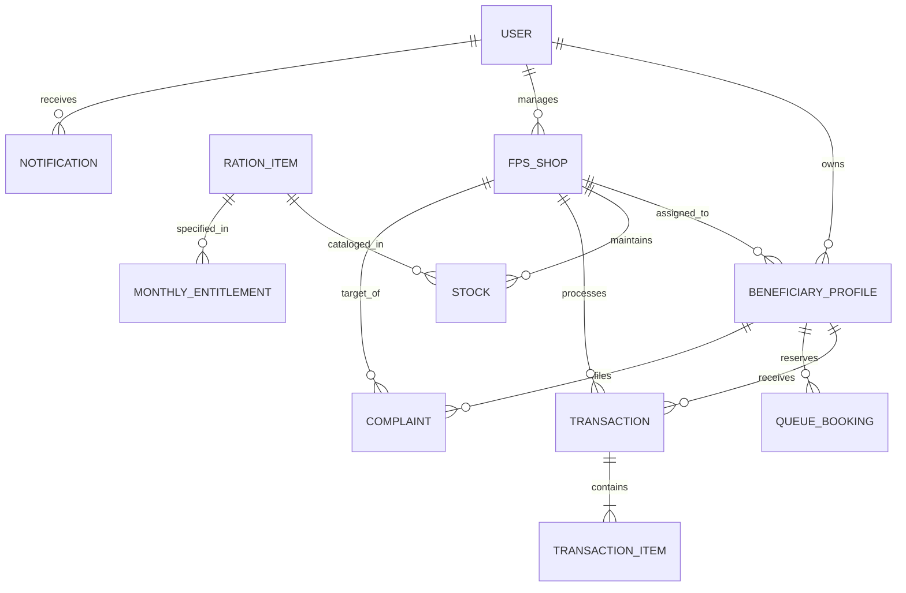

# Smart Ration Distribution System - Project Implementation Plan
*(Aligned with ISO/IEC/IEEE 29148 SRS Standards)*

---

## 1. System Overview & Architecture

### 1.1 Overview
The **Smart Ration Distribution System** modernizes the traditional Public Distribution System (PDS) by digitizing beneficiary entitlement tracking, implementing secure QR-based identity verification, automating shop stock updates, managing queues via time-slot reservations, facilitating grievances, and providing centralized administrative reporting and governance.

### 1.2 Tech Stack Selection
* **Frontend Application**: React / SPA with modern, high-contrast, accessible UI tokens, responsive layouts, embedded Camera QR Reader support (HTML5 QR Code API), and PDF receipt generator.
* **Backend API Server**: Node.js with Express (RESTful architecture) using modular controllers, service layers, and validation schemas.
* **Database & ORM**: SQLite / PostgreSQL with Prisma ORM / SQL Driver ensuring **ACID compliance** for atomic inventory updates and entitlement deductions.
* **Security & Auth**: JSON Web Tokens (JWT) with HTTP-only payload storage/Bearer header, `bcrypt` password hashing, and Role-Based Access Control (RBAC) middleware.
* **Optional AI Subsystem**: Light predictive regression module for stock-demand forecasting and anomaly detection algorithms.

---

## 2. User Roles & Access Control Matrix

| Feature / Module | Beneficiary | Shopkeeper | Administrator |
| :--- | :---: | :---: | :---: |
| Self-Registration & Profile View | Row Access | View Shop's Beneficiaries | Full Access |
| Digital Ration Card & QR Display | View Own | Scan & Read | Manage / Regenerate |
| Monthly Entitlement View | View Own Quota | View Shop Summary | Set & Update Policies |
| QR Verification & Ration Dispensing | - | Full Execute | View Logs |
| Stock Inventory & Updates | - | Read & Request Stock | Full Stock Management |
| Digital Receipt & Transaction Log | View Own Receipts | View Daily Shop Receipts | View All Transactions |
| Queue Slot Booking | Book / Cancel Slot | Manage Day Queue | View Metrics |
| Notifications | Receive Alerts | Receive Stock/Queue Alerts | Broadcast Alerts |
| Complaint Management | Submit & View Status | View FPS Complaints | Resolve & Respond |
| Analytics & Reports | - | FPS Daily Report | Global PDS Reports |

---

## 3. Database Schema & Entities



### Key Data Entities
1. **User**: `id`, `name`, `email`, `phone`, `password_hash`, `role` (`BENEFICIARY`, `SHOPKEEPER`, `ADMIN`), `status`, `created_at`
2. **BeneficiaryProfile**: `id`, `user_id`, `ration_card_number`, `qr_token`, `category` (`BPL`, `AAY`, `APL`), `family_members_count`, `fps_shop_id`, `address`, `income_group`
3. **FPSShop** (Fair Price Shop): `id`, `shopkeeper_id`, `shop_code`, `shop_name`, `address`, `district`, `pincode`, `contact_number`
4. **RationItem**: `id`, `item_code`, `name`, `unit` (`KG`, `LITER`), `standard_price_per_unit`
5. **MonthlyEntitlement**: `id`, `category`, `ration_item_id`, `quota_per_member`, `quota_flat_per_card`, `subsidized_price_per_unit`, `effective_month_year`
6. **Stock**: `id`, `fps_shop_id`, `ration_item_id`, `quantity_available`, `last_updated`
7. **Transaction**: `id`, `transaction_ref`, `beneficiary_id`, `fps_shop_id`, `timestamp`, `total_amount`, `verification_mode` (`QR_CODE`, `MANUAL_OVERRIDE`), `status`
8. **TransactionItem**: `id`, `transaction_id`, `ration_item_id`, `quantity_dispensed`, `price_per_unit`, `total_price`
9. **QueueBooking**: `id`, `beneficiary_id`, `fps_shop_id`, `booking_date`, `time_slot`, `token_number`, `status` (`BOOKED`, `COMPLETED`, `CANCELLED`, `MISSED`)
10. **Complaint**: `id`, `ticket_id`, `beneficiary_id`, `fps_shop_id`, `category`, `subject`, `description`, `status` (`PENDING`, `IN_PROGRESS`, `RESOLVED`, `REJECTED`), `admin_response`, `created_at`, `resolved_at`
11. **Notification**: `id`, `user_id`, `title`, `message`, `type`, `is_read`, `created_at`
12. **AuditLog**: `id`, `user_id`, `action`, `entity_affected`, `ip_address`, `timestamp`

---

## 4. API Endpoints Specification

### 4.1 Authentication & Profile API
* `POST /api/auth/register` - Beneficiary registration.
* `POST /api/auth/login` - User authentication, returns JWT token & user role context.
* `GET /api/auth/me` - Validates JWT and returns current user details.

### 4.2 Beneficiary & Digital Card API
* `GET /api/beneficiary/profile` - Retrieves complete profile and assigned FPS shop details.
* `GET /api/beneficiary/ration-card` - Retrieves digital card data, QR payload, and entitlement summary.
* `GET /api/beneficiary/entitlements` - Computes active month entitlements based on card category and family size.

### 4.3 QR Verification & Distribution Terminal API
* `POST /api/distribution/verify-qr` - Scans QR payload, validates beneficiary identity, shop association, and remaining entitlement balance.
* `POST /api/distribution/dispense` - Atomically executes ration dispensing: creates transaction, updates stock, deducts entitlement balance, and issues digital receipt.
* `GET /api/distribution/receipt/:transactionRef` - Retrieves printable digital receipt details.

### 4.4 Stock Management & Monitoring API
* `GET /api/stock/fps/:shopId` - Fetches current stock inventory for a shop.
* `POST /api/stock/replenish` - Admin/Shopkeeper stock addition & logging.
* `GET /api/stock/alerts` - Returns items breaching minimum threshold.

### 4.5 Queue Booking API
* `GET /api/queue/slots` - Fetches available queue time slots for a given FPS shop and date.
* `POST /api/queue/book` - Reserves a time slot and generates token number.
* `PATCH /api/queue/cancel/:bookingId` - Cancels a queue booking.
* `GET /api/queue/shop-queue/:shopId` - Shopkeeper view of daily slots and live queues.

### 4.6 Complaints & Support API
* `POST /api/complaints/submit` - Beneficiary files a grievance.
* `GET /api/complaints/my-complaints` - Beneficiary complaint history.
* `GET /api/admin/complaints` - Admin desk for viewing grievances.
* `PATCH /api/admin/complaints/:id/resolve` - Admin updates complaint status and provides resolution notes.

### 4.7 Admin & Analytics API
* `GET /api/admin/users` - Admin user management list.
* `GET /api/admin/fps-shops` - Admin shop directory.
* `POST /api/admin/entitlement-policy` - Configure monthly ration quotas per category.
* `GET /api/reports/distribution-analytics` - Aggregated charts and distribution data.

### 4.8 Optional AI Endpoints
* `GET /api/ai/predict-demand` - Forecasts next month's item demand per district/shop.
* `GET /api/ai/anomaly-detection` - Highlights suspicious distribution spikes or pattern irregularities.

---

## 5. UI Layout & Application Structure

```
src/
├── components/
│   ├── common/        # Navbar, Sidebar, Footer, Modal, StatCard, Badge
│   ├── qr/            # QRGenerator, QRScannerModal, QRScannerCamera
│   ├── distribution/  # DispenseForm, ReceiptViewer, EntitlementProgress
│   ├── queue/         # SlotPicker, TokenCard, QueueList
│   └── complaints/    # ComplaintForm, TicketStatusBadge, ResolutionModal
├── pages/
│   ├── auth/          # Login, Register
│   ├── beneficiary/   # Dashboard, DigitalCard, Entitlements, Queue, History, Complaints
│   ├── shopkeeper/    # Dashboard, Terminal (QR Scan & Dispense), Inventory, QueueManager, SalesLog
│   └── admin/         # Dashboard, UserMgmt, ShopMgmt, EntitlementsConfig, GrievanceDesk, Analytics
├── services/          # api.js, authService.js, qrService.js, exportService.js
├── context/           # AuthContext, NotificationContext, ThemeContext
└── utils/             # formatters.js, validation.js, mockData.js
```

---

## 6. Functional & Non-Functional Requirements Mapping Checklist

### 6.1 Functional Requirements Checklist (FR-01 to FR-15)

- [ ] **FR-01: Beneficiary Registration & Profile Management**
  * Implementation: Public self-service registration form for beneficiaries + Admin beneficiary profile creation interface. Validates Aadhaar/Ration ID formats, income bracket, category, and assigns appropriate Fair Price Shop.
- [ ] **FR-02: Digital Ration Card & Unique QR Code Generation**
  * Implementation: Interactive digital card view displaying card number, family size, category (BPL/AAY/APL), and a cryptographic signed QR code containing encrypted validation tokens.
- [ ] **FR-03: Monthly Ration Entitlement Calculation & Display**
  * Implementation: Dynamic entitlement engine calculating per-member quotas (e.g., Rice 5kg/member, Wheat 3kg/member, Sugar 1kg/flat) and displaying available balance vs claimed balance for the current calendar month.
- [ ] **FR-04: QR-based Beneficiary Verification by Shopkeepers**
  * Implementation: Web camera integrated live scanner in Shopkeeper Terminal with fallback token entry to verify beneficiary eligibility, card status, and current month entitlement balance instantly.
- [ ] **FR-05: Real-time Stock Inventory Management & Auto-Deduction**
  * Implementation: Atomic transaction logic that automatically deducts dispensed quantities from the FPS Shop inventory upon transaction confirmation.
- [ ] **FR-06: Ration Distribution Transaction Processing**
  * Implementation: Multi-item checkout interface for shopkeepers to select ration items, input quantities up to maximum remaining entitlement, calculate total subsidized cost, and finalize distribution.
- [ ] **FR-07: Digital Receipts & Transaction History**
  * Implementation: Instant receipt popup with printable/downloadable PDF capabilities and a searchable transaction log for both Beneficiary (own) and Shopkeeper/Admin (shop/global).
- [ ] **FR-08: Stock Monitoring & Low Stock Alerts**
  * Implementation: Stock dashboard displaying inventory progress bars, color-coded status badges, and automated low-stock warning banners when inventory drops below safety thresholds.
- [ ] **FR-09: Queue Slot Booking System**
  * Implementation: Time-slot selection calendar (e.g., 9:00 AM - 10:00 AM) allowing beneficiaries to reserve collection times to prevent shop overcrowding, generating printable digital queue tokens.
- [ ] **FR-10: Multi-channel System Notifications**
  * Implementation: Toast notification center and in-app message inbox alerting users about quota resets, successful transactions, queue reminders, and grievance status updates.
- [ ] **FR-11: Complaint & Grievance Submission**
  * Implementation: Beneficiary portal tool to lodge complaints regarding short-rationing, quality issues, or shop closures, attach notes, and track ticket status.
- [ ] **FR-12: Complaint Resolution Workflow**
  * Implementation: Admin Grievance Management Desk listing incoming tickets with filter options, ticket escalation flags, and official response submission interface.
- [ ] **FR-13: Centralized Administrator Management Dashboard**
  * Implementation: System overview dashboard with key performance indicators (total beneficiaries, total ration distributed, active FPS shops, pending grievances) and user/shop management CRUD interfaces.
- [ ] **FR-14: Distribution Reports & Analytics**
  * Implementation: Data analytics dashboard featuring chart visuals (monthly distribution trends, stock consumption per district, category breakdown) and CSV/PDF export tools.
- [ ] **FR-15: System Audit Logs & Role Security**
  * Implementation: System audit trail logging security events, stock adjustments, manual override dispensing, and administrative policy updates.

### 6.2 Non-Functional Requirements Checklist (NFR-01 to NFR-07)

- [ ] **NFR-01: Performance & Response Time**
  * Target: QR code scan & verification < 1.5s; transaction processing & receipt generation < 2.0s.
- [ ] **NFR-02: Security & Data Encryption**
  * Target: Passwords hashed with `bcrypt`, JWT auth with role verification middleware, encrypted QR token signature preventing spoofing.
- [ ] **NFR-03: Reliability & Data Integrity**
  * Target: Database transactions with atomic lock mechanics to eliminate race conditions during simultaneous dispensing and stock updates.
- [ ] **NFR-04: Usability & Accessibility**
  * Target: Responsive mobile-friendly UI, clear iconography, WCAG contrast compliance, and high-legibility fonts.
- [ ] **NFR-05: Scalability & Modular Structure**
  * Target: Service-oriented modular code structure facilitating addition of new ration categories or hardware integrations.
- [ ] **NFR-06: ISO/IEC/IEEE 29148 Standard Adherence**
  * Target: Requirements documented with explicit priority, unique IDs, unambiguous verifiable conditions, and trace matrix.
- [ ] **NFR-07: System Availability**
  * Target: Robust error handling, graceful API degradation, offline mock fallbacks for network interruptions.

### 6.3 Optional Future Enhancements

- [ ] **OFR-01: AI Stock-Demand Prediction**
  * Description: Predictive model calculating upcoming month inventory requirements per shop based on historical consumption trends and seasonal factors.
- [ ] **OFR-02: AI Anomaly & Fraud Pattern Detection**
  * Description: Pattern analysis detecting unusual distribution spikes, off-hours dispensing, or repeated maximum-quota claims in short intervals.

---

## 7. Key Assumptions & Design Decisions

1. **Hardware Interfacing**: Camera QR scanning will utilize standard web APIs (`navigator.mediaDevices.getUserMedia` / HTML5-qrcode) to enable operation on standard laptops, tablets, and mobile devices without requiring proprietary physical scanners.
2. **Entitlement Reset Cycle**: Ration entitlements auto-renew on the 1st day of every calendar month.
3. **Queue Slot Capacity**: Each 1-hour time slot defaults to a maximum capacity of 15 beneficiaries per FPS shop to balance queue loads.
4. **Offline Resilience**: Mobile-first UI caches beneficiary digital ration cards locally so QR codes can be displayed even without active internet access.
5. **Demonstration Dataset**: The system will seed realistic initial data (Admin, 2 FPS Shops, 5 Beneficiaries across BPL/AAY/APL categories, items: Rice, Wheat, Sugar, Kerosene, Oil) for immediate interactive evaluation.

---

## 8. Next Execution Steps

Upon user approval of `PROJECT_PLAN.md`:
1. Initialize project structure with modern CSS tokens, design systems, and components.
2. Set up Backend API routes, Auth controllers, and Database schema seeds.
3. Construct Role-Based Navigation & Shared Layouts.
4. Implement Beneficiary Portal (Ration Card, QR, Entitlements, Queue, Complaints).
5. Implement Shopkeeper Verification & Ration Dispensing Terminal (QR Scanner, Stock updates, Receipt printing).
6. Implement Administrator Management Dashboard (Users, FPS Shops, Policies, Grievances, Analytics).
7. Run end-to-end integration tests & verify all checklist items (FR-01 to FR-15, NFR-01 to NFR-07).
